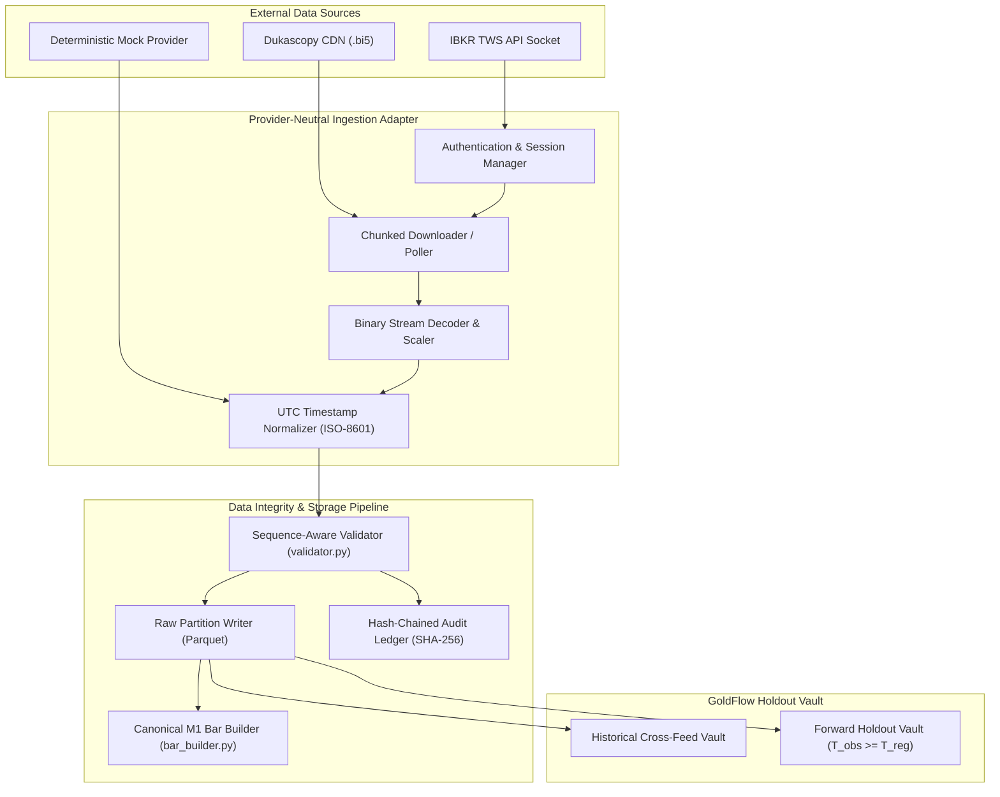

# GoldFlow Phase 6B: Provider Selection & Architectural Recommendation

**Author:** Senior Quantitative Research Engineer & Financial Data Architect  
**Date:** 2026-10-28  
**Status:** Canonical Architectural Recommendation & Action Plan  
**Primary Instrument:** XAUUSD (Gold Spot Bullion vs. US Dollar)  
**Selected Primary Provider:** Dukascopy Bank SA  
**Selected Secondary / Fallback Provider:** Interactive Brokers (IBKR)  
**Disqualified Provider:** TrueFX (Integral) — Absence of XAUUSD Data  
**Deprioritized Institutional Providers:** LMAX Exchange (Prohibitive Cost), LMAX Global (Funded Account Prerequisite)  

---

## 1. Executive Summary & Selection Decision

Following an exhaustive feasibility and technical due diligence study across five market-data providers (documented in [PHASE6B_PROVIDER_REQUIREMENTS.md](file:///c:/Users/ousse/Downloads/GoldFlow_Ultimate_Updated/GoldFlow_SMC_Primary_Updated/reports/phase6/PHASE6B_PROVIDER_REQUIREMENTS.md) and [PHASE6B_PROVIDER_COMPARISON.md](file:///c:/Users/ousse/Downloads/GoldFlow_Ultimate_Updated/GoldFlow_SMC_Primary_Updated/reports/phase6/PHASE6B_PROVIDER_COMPARISON.md)), this report delivers the formal selection recommendation and adapter architectural specification for GoldFlow Phase 6.

### The Recommendation
1. **Primary Recommended Candidate:** **Dukascopy Bank SA**
   - **Rationale:** Supplies multi-decade, millisecond-precision tick-by-tick Bid/Ask quotes for `XAU/USD` (2003–present). The public datafeed requires **zero upfront financial capital**, **no account creation**, and **no credentials**, while fully permitting the local retention and analytical derivation of OHLC bars for non-commercial research.
2. **Strongest Secondary / Fallback Candidate:** **Interactive Brokers (IBKR)**
   - **Rationale:** World-class regulated multi-asset broker supporting genuine real-time streaming via TWS API / IB Gateway. It serves as an optimal candidate for live forward streaming, but is deprioritized for historical backfills due to severe API pacing constraints (30 Bid/Ask requests per 10 minutes at 1,000 ticks/request) and a 3-year historical lookback ceiling.
3. **Disqualified Candidates:**
   - **TrueFX:** Formally disqualified for primary research because its free archives and streaming APIs cover foreign exchange pairs only and do not provide XAUUSD (Gold) market data.
   - **LMAX Exchange:** Deprioritized due to commercial barriers (\$1,000s/month connectivity and market data fees, institutional MTF membership agreements).
   - **LMAX Global:** Deprioritized for initial research feasibility due to mandatory funded brokerage account deposits and lack of a free historical tick archive.

---

## 2. Provider-Neutral Adapter Architectural Specification (Phase 6C Blueprint)

To maintain absolute provider independence, all future external data sources must interface through GoldFlow's standardized `DataIngestionProvider` protocol ([base.py](file:///c:/Users/ousse/Downloads/GoldFlow_Ultimate_Updated/GoldFlow_SMC_Primary_Updated/src/data/ingestion/base.py)). 

No provider-specific logic, data frames, or raw network packets may leak into the core backtesting engine, the frozen SMC strategy, or the holdout vault.



### 2.1 Specification of Required Adapter Subsystems

#### 1. Authentication & Session Management
- **Interface Contract:** `is_authenticated() -> bool`.
- **Implementation Rules:** 
  - For unauthenticated feeds (Dukascopy public CDN): Returns `True` by default.
  - For authenticated feeds (IBKR, LMAX): Reads credentials exclusively from environment variables (`GOLDFLOW_IB_PORT`, `GOLDFLOW_LMAX_KEY`). If variables are absent, raises `AuthenticationError` gracefully. Zero credentials hardcoded in source code or committed to Git.

#### 2. Historical Retrieval & Partition Chunking
- **Interface Contract:** `fetch_historical_ticks(symbol, start_time, end_time) -> Tuple[List[RawTickObservation], Dict]`.
- **Partitioning Strategy:**
  - Requests covering multi-day windows must be segmented internally into modular hourly or daily chunks.
  - For Dukascopy, requests map directly to hourly URL paths (`YYYY/MM/DD/HHh_ticks.bi5`).
  - Downloads must execute sequentially with configurable rate-limiting delays (e.g. 150ms sleep between requests) to prevent CDN connection refusal.

#### 3. Binary Stream Decompression & Price Scaling
- **Decompression:** Dukascopy `.bi5` files require raw LZMA stream decompression (`lzma.decompress(data)`).
- **Record Parsing:** Decompressed payloads must be unpacked as contiguous 20-byte records using big-endian format `>3I2f`:
  - `uint32` (Milliseconds offset from start of hour) $\to$ local hour timestamp + offset.
  - `uint32` (Raw Ask) $\to$ scaled by `point_scale` (divide by `1000.0` for XAUUSD).
  - `uint32` (Raw Bid) $\to$ scaled by `point_scale` (divide by `1000.0` for XAUUSD).
  - `float32` (Ask Volume) $\to$ volume in contracts/millions.
  - `float32` (Bid Volume) $\to$ volume in contracts/millions.

#### 4. UTC Normalization & Event Identification
- **Timestamp Contract:** Every observation must be transformed into a UTC-aware `pd.Timestamp` with millisecond resolution.
- **Sequence IDs:** For flat-file streams where explicit matching-engine sequence numbers are omitted, the adapter generates deterministic monotonic intra-partition sequence IDs ($0, 1, 2, \dots, N-1$) based on file record index, enabling downstream sequence-aware deduplication.

#### 5. Retry Logic, Exponential Backoff & Incomplete-Response Detection
- **Network Resilience:** HTTP requests must utilize a retry decorator with randomized exponential backoff (e.g., initial backoff 1.0s, multiplier 2.0, max retries 5).
- **Integrity Verification:** 
  - If a decompressed payload length is not an exact multiple of 20 bytes, the chunk is flagged as truncated and rejected.
  - Empty responses during normal trading hours (non-weekend, non-holiday) trigger an audit log warning.

#### 6. Manifest Generation & Hash Chaining
- Every ingested batch writes:
  - An atomic Snappy-compressed Parquet file in `goldflow_vault/raw_vault/`.
  - A sidecar JSON manifest (`.manifest.json`) containing: partition SHA-256 hash, raw tick count, valid tick count, dropped count, earliest observation time, latest observation time, and ingestion receipt time.
  - A hash-chained entry appended to `ingestion_history.jsonl` ($\text{Hash}_i = \text{SHA256}(\text{Hash}_{i-1} \,\|\, \text{Payload}_i)$).

---

## 3. Strict Separation of Research Workflows

To preserve scientific rigor, GoldFlow enforces an absolute architectural distinction between **Historical Cross-Provider Evaluation** and **Forward Temporal Evaluation**.

```text
+---------------------------------------------------------------------------------------------------+
|                                 GOLDFLOW DUAL RESEARCH WORKFLOWS                                  |
+-------------------------------------------------+-------------------------------------------------+
| WORKFLOW 1: CROSS-PROVIDER EVALUATION           | WORKFLOW 2: FORWARD TEMPORAL EVALUATION         |
+-------------------------------------------------+-------------------------------------------------+
| Purpose: Feed Generalization & Spread Robustness| Purpose: True Out-of-Sample Forward Validation  |
| Time Boundary: Historical (T_obs < T_reg)       | Time Boundary: Strictly Forward                 |
| Data Origin: Pre-existing historical archives   | Condition: T_obs >= T_reg AND T_ingest >= T_reg |
| Storage: goldflow_vault/raw_vault/historical/   | Storage: goldflow_vault/raw_vault/forward/      |
| Gate Check: Manifest & config hash verified     | Gate Check: Dual-timestamp forward eligibility  |
| Rule: NEVER labeled as forward observations     | Rule: Single-pass consumption lock enforced     |
+-------------------------------------------------+-------------------------------------------------+
```

### 3.1 Workflow 1 — Historical Cross-Provider Evaluation
- **Objective:** Determine whether SMC order-block and liquidity setups discovered on MT5 broker data generalize to institutional ECN feeds (Dukascopy / LMAX), or whether they are artifacts of retail broker markup and synthetic quote smoothing.
- **Data Ingestion Rules:**
  - Observations are tagged with `evaluation_type: HISTORICAL_CROSS_PROVIDER`.
  - Stored in `goldflow_vault/raw_vault/historical_cross/`.
  - **Invariant:** Downloading historical data after an evaluation registration timestamp **does NOT convert it into forward data**. Attempting to pass historical partitions to a forward evaluation gate will be rejected with `ForwardEligibilityError` (`"LOOK-AHEAD / HISTORICAL BACKFILL REJECTED"`).

### 3.2 Workflow 2 — Forward Temporal Evaluation (Holdout Vault)
- **Objective:** Evaluate the frozen SMC v1 strategy on genuinely unobserved market data that unfolds strictly after all strategy rules, parameters, and evaluation protocols have been cryptographically committed.
- **Data Ingestion Rules:**
  - Evaluation protocol pre-registered in `goldflow_vault/evaluations/` recording:
    - Target strategy name (`SMC_v1_frozen`).
    - Exact strategy config hash (`1091fb06b24491925510e642052305ba99e397e5f602c2ca2bdbd32094e7174a`).
    - Git commit SHA (`ad9807f8405811d65148d73d72139243f3d6a77f`).
    - Registration timestamp $T_{\text{reg}}$.
  - Ingestion pipeline collects new data streams into `goldflow_vault/raw_vault/forward/`.
  - Every observation must satisfy the **Dual-Timestamp Mathematical Invariant**:
    $$T_{\text{obs}} \ge T_{\text{reg}} \quad \land \quad T_{\text{ingest}} \ge T_{\text{reg}}$$
  - **Handling Delayed Messages & Network Reconnects:**
    - If a network reconnect occurs and the provider transmits buffered historical ticks where $T_{\text{obs}} < T_{\text{reg}}$, those ticks are immediately routed to a quarantined catch-up file and rejected by the forward gate.
    - If out-of-order packets arrive ($T_{\text{obs}, i} < T_{\text{obs}, i-1}$), the sequence-aware validator logs an `OUT_OF_ORDER` event and re-sorts within a rolling 5-second buffer before committing to Parquet.
  - **Single-Pass Evaluation Gate:** Once evaluated, the dataset's SHA-256 hash is permanently recorded in `consumed_datasets.json`. Any attempt to re-evaluate the same dataset is aborted with `DatasetAlreadyConsumedError`.

---

## 4. Unverified Claims & Explicit Disclosures

To preserve documentation integrity, the following open technical and commercial items are explicitly disclosed:

| Item | Provider | Status | Research Impact & Verification Strategy |
| :--- | :--- | :--- | :--- |
| **Scraping Longevity** | Dukascopy | `REQUIRES_PROVIDER_CONFIRMATION` | Public HTTP downloads on `datafeed.dukascopy.com` operate reliably under moderate pacing, but lack an explicit formal SLA for non-account holders. Must implement respectful pacing ($\le 5$ req/sec). |
| **Continuous Demo Feeds** | Dukascopy | `REQUIRES_PROVIDER_CONFIRMATION` | JForex demo accounts may require periodic manual renewal (every 14 days) to maintain persistent live WebSocket streaming. Batch polling of hourly `.bi5` files provides a robust alternative. |
| **Residency Restrictions** | IBKR | `REQUIRES_PROVIDER_CONFIRMATION` | Access to spot bullion `XAUUSD` via IdealPro depends on user account country of legal residence (non-US residents have spot access; US residents are restricted to futures `GC`). |
| **Weekly Maintenance Reboot** | IBKR | `REQUIRES_PROVIDER_CONFIRMATION` | IB Gateway enforces a mandatory weekly server restart every weekend, requiring an automated watchdog script (e.g. `IBC` / `IBController`) to re-establish forward collection sockets. |
| **Enterprise Gold Feeds** | TrueFX | `REQUIRES_PROVIDER_CONFIRMATION` | While TrueFX public feeds lack XAUUSD, Integral offers enterprise precious metals feeds. However, this is outside the scope of free due diligence. |

---

## 5. Phase 6C Implementation Prerequisites & Action Plan

Before implementing the external provider adapter in Phase 6C, the following conditions must be satisfied:

### 5.1 Repository Baseline & Working-Tree Checkpoint Plan
- **Git State:** Current HEAD is `ad9807f8405811d65148d73d72139243f3d6a77f` on branch `main`.
- **Working Tree:** Contains 17 modified tracked files and untracked research modules.
- **Checkpoint Requirement:** Prior to introducing external networking code, the operator should review modified files (`git diff HEAD`) and optionally create a clean git checkpoint branch (e.g. `git checkout -b feature/phase6-market-data-ingestion`) to cleanly segregate working-tree changes without discarding any historical research artifacts.

### 5.2 Phase 6C Technical Milestones
1. **Milestone 1 — Dukascopy Adapter Implementation (`DukascopyIngestionProvider`):**
   - Implement `src/data/ingestion/dukascopy_provider.py` conforming to `DataIngestionProvider`.
   - Incorporate LZMA decompression, 20-byte record decoding, UTC normalization, and hourly URL mapping.
   - Decouple all networking so tests run against deterministic local binary fixtures.
2. **Milestone 2 — Mock & Fixture Integration Testing:**
   - Create synthetic `.bi5` binary fixtures in `tests/fixtures/` with known timestamps, bid/ask prices, and crossed-quote anomalies.
   - Verify that all existing 496 tests continue to pass without regression.
3. **Milestone 3 — Cross-Provider Feed Reconciliation Tool:**
   - Build a research script (`scripts/reconcile_feeds.py`) comparing MT5 historical bars against Dukascopy-derived bars over the identical date range (October 2026) to quantify spread differences, slippage variance, and FVG/liquidity sweep alignments.
4. **Milestone 4 — Forward Evaluation Pre-Registration:**
   - Pre-register the frozen SMC v1 strategy configuration with the evaluation gate prior to collecting any live forward data partitions.

