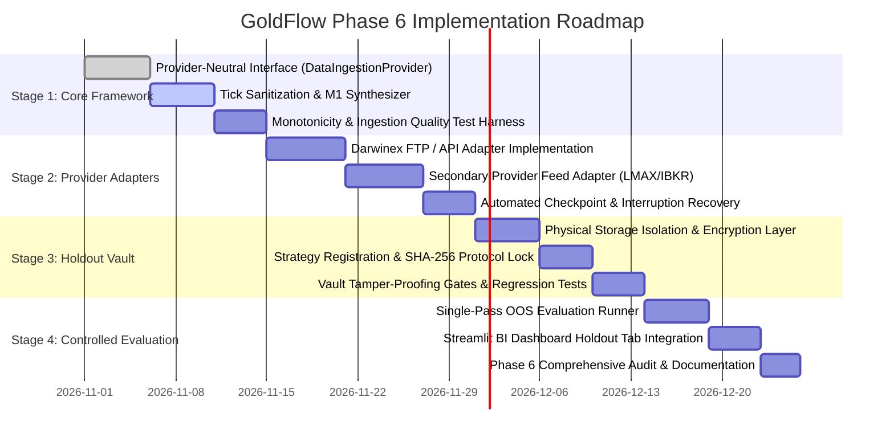

# GoldFlow Phase 6 — Forward Data Ingestion & Independent Holdout Vault Architecture Proposal

**Author:** Quantitative Research Engineer & Financial Data Architect  
**Date:** 2026-10-28  
**Target Instrument:** XAUUSD (Gold / US Dollar Spot & CFD)  
**Target Repository:** GoldFlow SMC Primary Platform  
**Target Delivery Path:** `reports/phase6/PHASE6_ARCHITECTURE_PROPOSAL.md`  
**Status:** **TECHNICAL PROPOSAL & SPECIFICATION (NO LIVE EXECUTION / NO ACCOUNT COMMITMENTS)**

---

## 1. Executive Summary & Motivation

Phase 5 concluded with a fundamental methodological verdict: **the existing GoldFlow repository possesses zero genuine out-of-sample (OOS) data**. All four historical datasets (`H4`, `H1`, `M15`, `M5`) originate from a single MetaQuotes-Demo broker export and were visible during prior strategy exploration, indicator threshold calibration, and parameter formulation. Furthermore, the positive M15 multi-timeframe result (+$506.56) is based on only 11 closed trades, where 137.4% of total profit depends on a single outlier trade (`SMC_M15_0053`).

To advance from an exploratory research prototype to an institutional-grade trading system, GoldFlow requires **Phase 6: Forward Data Ingestion & Independent Holdout Vault**.

Phase 6 provides:
1. A **provider-neutral data ingestion engine** capable of acquiring millisecond-precision tick and bid/ask observations for XAUUSD.
2. A **cryptographically protected, physically isolated Holdout Vault** separating development data from evaluation data.
3. A **formal strategy registration and single-pass evaluation protocol** to permanently eliminate backtest overfitting, data peeking, and confirmation bias.
4. An **adversarial ingestion quality harness** with automated checks for timestamp distortion, sequence gaps, and data corruption.

---

## 2. System Architecture & Component Interactions

```mermaid
flowchart TD
    subgraph MarketSources["External Data Feeds (Read-Only)"]
        DWX["Darwinex FTP / API"]
        LMAX["LMAX FIX / REST / S3"]
        IBKR["IBKR TWS API / Gateway"]
    end

    subgraph Phase6Ingestion["Phase 6 Ingestion Pipeline"]
        Adapter["Provider Adapter (DataIngestionProvider ABC)"]
        Sanitizer["Tick Sanitizer & UTC Normalizer"]
        GapDetector["Duplicate & Out-of-Order Engine"]
        BarBuilder["M1 OHLC Bar Synthesizer (Optional)"]
    end

    subgraph StorageVault["Physical Storage Isolation"]
        DevStore["Development Store (data/development/)"]
        HoldoutVault["Protected Holdout Vault (data/vault/holdout/) [LOCKED]"]
        ManifestStore["Cryptographic Manifests (.manifest.json + SHA-256)"]
    end

    subgraph ResearchEnvironment["Quantitative Research & Evaluation"]
        DevResearch["Exploratory Strategy Tuning & Training"]
        Registry["Strategy & Protocol Registration (Frozen SHA-256)"]
        ControlledEval["Single-Pass Controlled Evaluation Runner"]
        AuditReport["Phase 6 OOS Audit Report"]
    end

    MarketSources --> Adapter
    Adapter --> Sanitizer
    Sanitizer --> GapDetector
    GapDetector --> BarBuilder
    BarBuilder --> ManifestStore
    
    ManifestStore -->|Partition: DEV (e.g. 70%)| DevStore
    ManifestStore -->|Partition: HOLDOUT (e.g. 30%)| HoldoutVault
    
    DevStore --> DevResearch
    DevResearch --> Registry
    Registry -->|Frozen Strategy Hash| ControlledEval
    HoldoutVault -.->|One-Time Decryption Key| ControlledEval
    ControlledEval --> AuditReport
```

---

## 3. Provider-Neutral Data Ingestion Architecture

### 3.1 Interface Specification (`DataIngestionProvider`)

To ensure GoldFlow remains completely decoupled from broker-specific SDKs or proprietary terminal protocols, all data acquisition must conform to the abstract interface below:

```python
from abc import ABC, abstractmethod
from dataclasses import dataclass
from datetime import datetime
from pathlib import Path
from typing import AsyncIterator, Dict, List, Optional
import pandas as pd

@dataclass(frozen=True)
class RawTickObservation:
    """Immutable single tick observation."""
    source_timestamp_utc: pd.Timestamp
    received_timestamp_utc: pd.Timestamp
    bid: float
    ask: float
    bid_volume: float
    ask_volume: float
    sequence_id: Optional[int] = None
    flags: int = 0

@dataclass(frozen=True)
class AggregatedBar:
    """Deterministic M1 or higher OHLC bar derived from ticks."""
    time: pd.Timestamp
    open: float
    high: float
    low: float
    close: float
    volume: float
    tick_count: int
    spread_open: float
    spread_close: float
    spread_min: float
    spread_max: float

class DataIngestionProvider(ABC):
    """Abstract Base Class for all external market data providers."""

    @abstractmethod
    def provider_name(self) -> str:
        """Return unique provider identifier (e.g., 'darwinex', 'lmax', 'ibkr')."""
        pass

    @abstractmethod
    def is_authenticated(self) -> bool:
        """Verify credential presence without triggering paid queries."""
        pass

    @abstractmethod
    async def fetch_historical_ticks(
        self,
        symbol: str,
        start_utc: datetime,
        end_utc: datetime,
    ) -> AsyncIterator[RawTickObservation]:
        """Stream historical tick observations in strict chronological order."""
        pass

    @abstractmethod
    async def stream_live_ticks(
        self,
        symbol: str,
    ) -> AsyncIterator[RawTickObservation]:
        """Stream forward live ticks for real-time forward collection."""
        pass

    @abstractmethod
    def get_instrument_specification(self, symbol: str) -> Dict[str, Any]:
        """Return canonical contract specs: contract size, tick size, calc mode."""
        pass
```

### 3.2 XAUUSD Tick and Bid/Ask Data Specifications

Gold trading exhibits high volatility, spread expansion during rollovers, and macro liquidity gaps. Ingestion schemas must record:
- **`timestamp_utc`**: Nanosecond/microsecond resolution in pure UTC.
- **`bid` / `ask`**: Raw bid and ask quotes (64-bit floating point or fixed-point decimal with 2 decimal places minimum, e.g. `2734.52`).
- **`bid_size` / `ask_size`**: Top-of-book volume in troy ounces or standard lots.
- **`spread_usd`**: Computed explicitly as `ask - bid` on every observation.
- **`feed_flags`**: Bitmask indicating trade vs quote update, indicative vs executable prices, and session state.

### 3.3 Optional Construction of M1 OHLC Bars

While tick backtesting represents the gold standard for execution modeling, SMC swing detection (fractal swings, structure breaks) operates on discrete timeframes (M5, M15, H1, H4). M1 bars serve as the atomic building block for synthesizing all higher timeframes.

#### Deterministic M1 Bar Synthesis Rules:
1. **Window Alignment:** Each M1 bar spans $[T, T + 60\text{s})$, timestamped at the **left edge** ($T$).
2. **Price Extraction:**
   - `open`: Mid-price $(\text{bid} + \text{ask}) / 2$ (or executable Bid) of the first tick where $\text{timestamp} \ge T$.
   - `high`: Maximum price observed within $[T, T + 60\text{s})$.
   - `low`: Minimum price observed within $[T, T + 60\text{s})$.
   - `close`: Mid-price of the final tick where $\text{timestamp} < T + 60\text{s}$.
3. **Spread Representation:** Store both point-in-time opening spread and volume-weighted average spread (VWAS) across the bar to preserve realistic transaction costs.
4. **No Synthetic Interpolation:** Zero-tick minutes (e.g. illiquid night hours or holidays) must **NOT** be filled with artificial flat candles (`close = open`). They must be omitted from the bar series, with the gap recorded in the dataset manifest.

---

## 4. Temporal Integrity, Timezones, and Gap Handling

### 4.1 Strict UTC Policy & Daylight Saving Time (DST)
- **Zero Local Wall-Clock Storage:** All incoming timestamps must be converted to UTC immediately upon ingestion at the adapter boundary. No naive or server-local timestamps (e.g. Athens UTC+2/+3 or NY UTC-5/-4) may be written to disk.
- **DST Discontinuity Prevention:** Gold market trading hours shift between US Eastern Daylight Time (EDT) and Eastern Standard Time (EST). Storing raw timestamps in UTC prevents artificial 1-hour gaps or overlapping candles during semi-annual clock shifts.

### 4.2 Sequence Validation & Out-of-Order Handling
Every batch of ticks must pass a temporal monotonicity validation pass:
1. **Duplicate Detection:** Observations with identical `timestamp_utc`, `bid`, `ask`, and `volume` are logged and deduplicated.
2. **Out-of-Order Recovery:** Ingestion networks occasionally deliver packets out of order. A sliding buffer (window: 2,000 ms) buffers and sorts incoming ticks by `timestamp_utc` before writing to the immutable vault. If a tick arrives with a timestamp older than the buffer horizon, it is flagged as `LATE_OBSERVATION` and routed to an audit ledger.
3. **Monotonicity Enforcement:** Processed files must satisfy $T_{i} \le T_{i+1}$ unconditionally.

### 4.3 Network Dropout & Recovery Engine
- **State Checkpoints:** The ingestion daemon maintains an append-only JSON journal (`ingestion_state.json`) recording the last confirmed sequence ID and timestamp.
- **Idempotent Resumption:** On network recovery, the engine queries the provider starting from `last_confirmed_timestamp - 60s` to ensure zero loss, passing the overlap through the deduplication filter.

---

## 5. Independent Holdout Vault Architecture

### 5.1 The Principle of Physical Data Separation
A core failure in quantitative finance is **peeking**—backtesting against "out-of-sample" data during strategy iteration. To enforce true out-of-sample validity, Phase 6 introduces physical and cryptographic boundaries.

```
data/
├── development/                      <-- Accessible to all research scripts
│   ├── XAUUSD_M15_dev.csv
│   └── XAUUSD_M5_dev.csv
├── vault/                            <-- RESTRICTED ACCESSIBILITY
│   ├── immutable_raw/                <-- Append-only raw tick archives (Parquet/Zstd)
│   ├── holdout/                      <-- ENCRYPTED / ACCESS-GATED
│   │   ├── XAUUSD_holdout.enc        <-- GCM-AES-256 encrypted forward data
│   │   └── vault_manifest.json       <-- SHA-256 hashes & timestamp bounds
│   └── manifests/
└── evaluation/                       <-- Single-pass output directory
    └── phase6_oos_audit.json
```

### 5.2 Strategy Registration & Frozen Cryptographic Lock
Before the Holdout Vault can be opened:
1. **Candidate Pre-Commitment:** The quantitative researcher must freeze the candidate strategy code and configuration into a sealed artifact.
2. **Registration Manifest:** The system generates a cryptographic commitment containing:
   - Git commit hash of the repository.
   - SHA-256 hash of the strategy configuration (`smc_v1_frozen.json` or MTF experiment config).
   - Python environment specification and package versions.
   - Formal evaluation protocol definition (cost multipliers, position sizing, evaluation window).
3. **Permanent Registration Record:** Saved in `configs/registered_evaluations/<registration_id>.json`.

### 5.3 Single-Pass Controlled Evaluation Protocol
Once registered, the evaluation script (`scripts/run_phase6_holdout_evaluation.py`) executes:
1. Validates that the current git working tree is clean and matches the registered commit.
2. Unlocks the Holdout Vault dataset for **one single execution pass**.
3. Streams the holdout data through the existing event-driven backtesting engine (`src/backtesting/engine.py`), applying conservative stop-loss-first collision rules and full transaction frictions.
4. Generates immutable audit artifacts (`reports/phase6/PHASE6_OOS_VERDICT.md`).
5. **Locks the Vault:** Marks the holdout segment as `EVALUATED_CONSUMED`. Any further attempt to backtest against this period is permanently rejected by the test gates.

### 5.4 Forward Validation vs. Cross-Provider Validation
Phase 6 strictly distinguishes two different verification dimensions that must never be conflated:

1. **Forward Validation (True Temporal Out-of-Sample):**
   - **Definition:** Evaluation on market data collected *forward in time* strictly after the strategy configuration, rules, and evaluation protocol have been frozen and registered.
   - **Crucial Methodological Rule:** Previously examined historical dates (including 2025-2026) **cannot and must not be designated as a genuine temporal holdout**, because the researcher has already seen price action, market regimes, and backtest results from those periods.
   - **Collection Boundary:** The forward collection boundary starts at $T_{\text{registration}} > 2026-10-28$. All data arriving after $T_{\text{registration}}$ is untouched, uninspected, and physically isolated until the pre-registered single-pass evaluation trigger.
   - **Purpose:** Tests strategy robustness against future market regimes, structural shifts, and forward non-stationarity without any risk of hindsight or selection bias.

2. **Cross-Provider Validation (Spatial / Liquidity-Pool Out-of-Sample):**
   - **Definition:** Evaluating the strategy over historical timeframes using independent, high-grade tick data from an alternative institutional liquidity pool (e.g., LMAX Exchange CLOB or Darwinex tick archives vs. MetaQuotes-Demo broker feed).
   - **Methodological Status:** This is a *cross-sectional / execution-feed validation*, NOT a temporal forward holdout. The researcher may already know general macro price behavior over those historical dates, but the specific tick paths, spread dynamics, order book queues, and slippage profiles are independent.
   - **Purpose:** Tests strategy sensitivity to broker pricing anomalies, artificial spread mark-ups, feed latency, and OHLC bar discretization artifacts.

---

## 6. Provider Comparative Evaluation

We conducted technical research into candidate providers based on developer documentation, API specifications, and industry operational disclosures.

> **Commercial Verification Notice:** All deposit minimums, fee schedules, licensing terms, and historical availability listed below represent preliminary technical findings and are **unverified claims requiring formal broker/exchange confirmation** before entering into any commercial relationship or account opening.

| Evaluation Criterion | **Darwinex** (Darwinex Zero / Classic) | **LMAX Global** (Brokerage Arm) | **LMAX Exchange** (Institutional MTF / CLOB) | **Interactive Brokers (IBKR)** |
|---|---|---|---|---|
| **Entity & Venue Type** | FCA/CNMV Brokerage | FCA-regulated Brokerage for pro/institutional clients | FCA-regulated Multilateral Trading Facility (MTF) Central Limit Order Book | US/Global Multi-Asset Brokerage |
| **Instrument Availability** | `XAUUSD` (Spot Gold CFD) | `XAU/USD` (Spot Gold Bullion CFD) | `XAU/USD` (Spot Gold Bullion Spot / Physical CLOB) | `XAUUSD` (Spot CMDTY / CFD) |
| **Historical Tick Depth** | Unverified claim: Continuous tick history from Oct 2017 to Present | Complete tick logs from account opening / historical archives | Millisecond/Microsecond ITCH/FIX market data archives | Strictly capped at **3 Years** maximum lookback |
| **Bid / Ask Availability** | Full Bid/Ask quote streams & tick logs via FTP / API | Top-of-Book (L1) and Depth (L2) Bid/Ask via FIX / REST | Full Depth of Book (L2/L3 ITCH multicast/TCP, millisecond timestamps) | Available via `whatToShow="BID_ASK"` |
| **Retrieval Limits & Pacing** | Bulk flat files via FTP (`tickdata.darwinex.com`); Python SDK (`darwinexapis`); no restrictive per-second pacing | High-throughput FIX/REST APIs; Cloud Data Delivery via AWS S3 / Snowflake | Direct FIX/ITCH connection in Equinix LD4 (London) / NY4; enterprise data distribution | **Severe Rate Limiting:** Hard cap of **1,000 ticks/request**; max 60 requests/10 min; BID_ASK counts twice |
| **Access Prerequisites** *(Unverified Claims)* | Account required; reported min deposit ~$500 (unverified; requires confirmation) | Professional client agreement; reported deposit $10k+ (unverified) | Institutional membership, minimum monthly volume commitments, credit lines (unverified) | Funded brokerage account + TWS Gateway active + Paid Level 1 Market Data Subscription |
| **Licensing & Retention** | Personal research use for account holders; redistribution prohibited | Commercial enterprise data licensing agreement | Formal institutional market data agreement (FCA MTF market data terms) | Personal research via TWS API; bulk scraping explicitly throttled/prohibited |
| **Suitability for GoldFlow** | **PRIMARY CANDIDATE (Rank 1):** Best balance of historical depth, bulk retrieval, bid/ask granularity, and accessible prerequisites | **SECONDARY BROKERAGE BENCHMARK (Rank 2):** Institutional-grade pricing for pro brokers | **INSTITUTIONAL REFERENCE (Rank 3):** Cleanest no-last-look matching engine, but institutional connectivity barriers | **LIVE STREAMING ONLY (Rank 4):** 1,000-tick pacing makes pulling years of gold ticks impractical; viable only for forward streaming |

### 6.1 Critical Distinction: LMAX Exchange vs. LMAX Global
Quantitative teams frequently conflate **LMAX Exchange** with **LMAX Global**. They are distinct entities with very different access profiles:
- **LMAX Exchange (Institutional MTF):** A regulated Multilateral Trading Facility operating a pure Central Limit Order Book (CLOB) with no "last look" execution. Servers are co-located in Equinix LD4 (Slough, UK) and NY4 (Secaucus, US). It caters strictly to institutional clients (tier-1 banks, market makers, proprietary trading desks) with significant monthly volume requirements, dedicated fiber/cross-connect infrastructure, and enterprise data licensing contracts.
- **LMAX Global:** The retail/brokerage arm of the LMAX Group, regulated to service professional and institutional clients with standard MT4/MT5 bridges, GUI, and FIX/REST API connectivity. While it draws liquidity from the LMAX Exchange CLOB, it operates as a broker with standard retail/pro account onboarding.

### 6.2 Provider Selection Assessment
1. **Darwinex is recommended as the initial exploration candidate** for tick acquisition and ongoing forward collection, subject to commercial verification of account terms.
2. **LMAX Global is the preferred cross-provider validation benchmark** for testing institutional execution pricing without requiring MTF exchange membership.
3. **Interactive Brokers is disqualified for tick backfill** due to its 1,000-tick pagination throttle, but may serve as an auxiliary live forward stream.
4. **No paid integration, account creation, or credential submission will occur** until the user explicitly selects a provider and approves the commercial terms.

---

## 7. Credential Security, Holdout Vault Access Control & Operational Resilience

### 7.1 Cryptographic Storage Architecture & Access Controls
The Holdout Vault (`data/vault/holdout/`) requires strict physical and logical access separation:

```
data/
├── development/                      <-- UNRESTRICTED: Accessible to all research scripts
│   ├── XAUUSD_M15_dev.csv
│   └── XAUUSD_M5_dev.csv
├── vault/                            <-- RESTRICTED: Read-only, access-monitored
│   ├── immutable_raw/                <-- Append-only raw tick archives (Parquet/Zstd)
│   ├── holdout/                      <-- LOCKED & ENCRYPTED FORWARD VAULT
│   │   ├── XAUUSD_forward_holdout.enc<-- AES-256-GCM encrypted forward ticks (post-registration)
│   │   ├── vault_manifest.json       <-- SHA-256 dataset hashes, row counts, timestamp bounds
│   │   └── access_audit.log          <-- Append-only access log (timestamp, caller, action, hash)
│   └── manifests/                    <-- Signed manifest history
└── evaluation/                       <-- Single-pass evaluation output
    └── phase6_oos_audit.json         <-- Immutable evaluation receipt
```

### 7.2 Access Control & Tamper Detection Specifications
1. **Operating-System Access Restrictions:**
   - In production environments, `data/vault/holdout/` is configured with strict OS-level permissions (read-only for the service account, inaccessible to standard development shells).
   - In local development, the vault is protected by software-enforced cryptographic locks (AES-256-GCM envelope encryption with a key held outside the repository).
2. **Append-Only Ingestion & Trusted Manifest Hashes:**
   - Incoming tick batches are appended to immutable monthly Parquet partitions. Existing chunks are never modified or overwritten.
   - Every partition update computes a SHA-256 hash stored in `vault_manifest.json`.
   - Before any evaluation run, the manifest hash is re-computed. Any byte discrepancy terminates the evaluation immediately with an `INTEGRITY_COMPROMISED` alert.
3. **Audit Logging:**
   - Every read or unlock request to `data/vault/holdout/` appends an entry to `access_audit.log` recording:
     `{"timestamp_utc": ..., "process_pid": ..., "caller_script": ..., "git_commit": ..., "action": "UNLOCK_EVALUATION"}`.
   - The log is append-only and monitored by regression tests.
4. **Interruption Recovery & Checkpointing:**
   - The ingestion daemon writes an atomic checkpoint file (`.checkpoint.json`) containing the last successfully processed tick timestamp and sequence ID.
   - Upon network drop, server restart, or provider timeout, the daemon reads the checkpoint and resumes ingestion from the exact next millisecond, preventing duplicate gaps or dropped records.
5. **Zero In-Repo Credentials:**
   - All credentials must be supplied via external environment variables (`GOLDFLOW_DWX_FTP_USER`, etc.) or secure secrets managers.
   - Pre-commit hooks block any commit containing tokens, passwords, or private keys.

### 7.2 Adversarial Ingestion Test Harness
Phase 6 requires an automated quality suite verifying:
- `test_detect_duplicate_timestamps`: Confirms duplicate removal without volume loss.
- `test_detect_out_of_order_sequence`: Verifies that sequence anomalies are caught and sorted.
- `test_detect_temporal_gaps`: Verifies that weekend/maintenance gaps are correctly classified and not filled with synthetic bars.
- `test_holdout_vault_tamper_detection`: Verifies that altering a single byte in the holdout directory invalidates the SHA-256 manifest and blocks evaluation.
- `test_strategy_hash_mismatch_blocks_evaluation`: Verifies that any code or config deviation from the registered strategy halts the single-pass runner.

---

## 8. Staged Implementation Plan



### Acceptance Criteria Matrix

| Stage | Deliverable | Acceptance Criteria |
|---|---|---|
| **Stage 1** | Ingestion Interface & Validator | `DataIngestionProvider` ABC compiled; synthetic tick test suite achieves 100% pass rate; M1 aggregator matches tick bounds exactly. |
| **Stage 2** | Darwinex / Provider Adapter | Ingests XAUUSD ticks; preserves millisecond UTC timestamps; deduplicates overlapping chunks; automatic resumption succeeds after simulated network disconnect. |
| **Stage 3** | Holdout Vault & Registration | Physical access segregation between dev and vault directories; SHA-256 manifest validation; strategy registration enforces frozen config hash match. |
| **Stage 4** | Controlled OOS Evaluation | Single-pass evaluation executes successfully without peeking; generates immutable audit report; vault locks immediately upon evaluation completion. |

---

## 9. Unresolved Decisions & Immediate Next Actions

Before initiating implementation, the following decisions require user alignment:
1. **Provider Account Selection:** Confirm whether Darwinex live account credentials exist or will be provided, or whether ingestion should begin with an open-source institutional archive (e.g. HuggingFace Parquet LMAX tick archives) for prototyping.
2. **Physical Storage Path:** Confirm the storage location for raw tick data (XAUUSD tick data requires ~2-5 GB per year in compressed Parquet format).
3. **Forward Collection Boundary & Protocol Registration Date:** Confirm the strategy freeze date $T_{\text{freeze}}$ (e.g. 2026-10-28). All future market data collected after $T_{\text{freeze}}$ will flow exclusively into the sealed Holdout Vault. Historical data from alternative providers prior to $T_{\text{freeze}}$ will be designated strictly as Cross-Provider Validation (spatial OOS), never as a temporal holdout.
4. **Commercial Terms Verification:** Confirm broker deposit requirements, data licensing agreements, and feed costs before connecting any production adapter. No paid commitments or account creations will be initiated without explicit user instruction.

---
*No live trading functionality has been introduced. No paid accounts or credentials were created or transmitted.*

